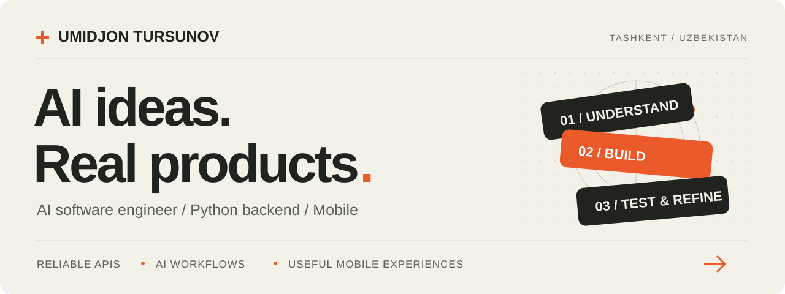

  <picture>
  <source media="(max-width: 600px)" srcset="./assets/profile-banner-mobile.svg" />
  
  </picture>

  <a href="https://www.linkedin.com/in/tursunovumidjon"><strong>LinkedIn</strong></a> &nbsp; / &nbsp;
  <a href="mailto:tursunov.umidjon.uz@gmail.com"><strong>Email</strong></a> &nbsp; / &nbsp;
  <a href="https://t.me/muydinov_u"><strong>Telegram</strong></a> &nbsp; / &nbsp;
  <a href="https://github.com/umidjontursunovhbai?tab=repositories"><strong>Public projects ↗</strong></a>

 

I build **AI-assisted products, Python backends, and mobile apps from the ground up**. I independently built the **UTAX AI mobile app** and **bRide Mobile** from scratch. My work connects what users experience with what happens behind the scenes: APIs, payments, chat, and operations.

I focus on making the difficult parts reliable — subscription upgrades, credit accounting, changing auth state, and conversations that stay consistent when the network doesn't.

### Products I built & contributed to

<table>
<tr>
<td width="50%" valign="top">
<picture><source media="(max-width: 600px)" srcset="./assets/wakil-mobile.svg" /></picture>

Fixed <strong>Standard-to-Pro upgrades and credit accounting</strong> across backend and web. Added regression tests for payments, billing periods, and concurrent credit use.

</td>
<td width="50%" valign="top">
<picture><source media="(max-width: 600px)" srcset="./assets/utax-mobile.svg" /></picture>

<strong>Independently built the UTAX AI Flutter mobile app from scratch.</strong> Developed AI chat, search and navigation, attachments, and persistent local auth. Integrated the mobile app with existing backend APIs.

</td>
</tr>
<tr>
<td width="50%" valign="top">
<picture><source media="(max-width: 600px)" srcset="./assets/kusherbayev-mobile.svg" /></picture>

Isolated search failures, kept <strong>outgoing messages visible during server lag</strong>, prevented deleted chats from returning, and refined message copying.

</td>
<td width="50%" valign="top">
<picture><source media="(max-width: 600px)" srcset="./assets/bride-mobile.svg" /></picture>

<strong>Independently built bRide Mobile from scratch, end-to-end.</strong> Developed the Flutter app for team attendance and operations, including multi-office check-in, schedules, and a unified inbox with Linear and Gmail integrations.

</td>
</tr>
</table>

### Live in the stores

All apps are published on the App Store and Google Play.

<table>
<tr>
<td width="50%" valign="top">
<h4>Wakil AI</h4>

AI legal help in Uzbek.

 

</td>
<td width="50%" valign="top">
<h4>UTAX AI</h4>

AI tax assistant, built with Flutter.

 

</td>
</tr>
<tr>
<td width="50%" valign="top">
<h4>Kusherbayev AI</h4>

AI chat app with reliable conversations.

 

</td>
<td width="50%" valign="top">
<h4>bRide Mobile</h4>

Team attendance and operations.

 

</td>
</tr>
<tr>
<td width="50%" valign="top">
<h4>Agro Bizness</h4>

AI assistant for agribusiness.

 

</td>
<td width="50%"></td>
</tr>
</table>

### AI automation at UzVIP

**AI Automation Engineer · Jun–Oct 2025**

I built the n8n workflows manually, including the workflow logic, integrations, error handling, and testing.

| Project | What I built |
| :--- | :--- |
| **eBay product-image automation** | A workflow to extract listing images, replace backgrounds with AI, and upload the results. Tracked processed listing IDs in Google Drive to avoid duplicate work. |
| **Multi-model AI chat platform** | A chat platform where users could choose ChatGPT, Gemini, Grok, or DeepSeek. Built model routing in n8n, connected the frontend, and integrated Stripe subscriptions and one-time payments. |
| **Custom GPT → Notion workflow** | Connected Custom GPT, n8n, and Notion to turn natural-language requests into structured workspace records. |
| **Telegram calendar assistant** | Connected a Telegram voice assistant with Gemini and Google Calendar for scheduling workflows. |

[Watch my n8n project demos ↗](https://www.youtube.com/@muydinov-n8n) · Videos in Uzbek.

### What I work with

        

Also: AI agents, MCP, API and webhook integrations, and automated tests for delivery and maintenance.

### A few things you can explore

<table>
<tr>
<td width="33%" valign="top"><h4><a href="https://github.com/umidjontursunovhbai/SmartSpend">SmartSpend</a></h4>
Native iOS expense tracker with budgets, recurring expenses, and Home Screen widgets.
</td>
<td width="33%" valign="top"><h4><a href="https://github.com/umidjontursunovhbai/project-ledger">Project Ledger</a></h4>
Project finance workspace for income, expenses, invoices, team access, and billing imports.
</td>
<td width="33%" valign="top"><h4><a href="https://github.com/umidjontursunovhbai/telegram-dm-assistant">Telegram DM Assistant</a></h4>
AI inbox assistant with local reply drafts and configurable auto-replies.
</td>
</tr>
</table>
